# enterprise_manual_data_ingestion
Enterprise-grade data ingestion pipeline that automates data ingestion, transformation and validation workflows. Built to showcase best practices in data engineering, including orchestration, incremental loading, lineage, and analytics-ready data delivery.

## Architecture

```mermaid
flowchart TD

A["🏛️ Ingestion Control Layer
• Config Driven Framework
• Control Tables
• Watermark Management
• Last Successful Load
• Dynamic Scheduling
• Retry Framework
• Backfill Framework
• SLA Management
• Domain Ownership
• Data Contracts"]

B["📥 Source Systems
• Azure Blob
• SFTP
• APIs
• SharePoint
• Kafka
• SAP
• Salesforce
• Oracle
• SQL Server
• CDC Sources
• CSV / JSON / XML / Parquet"]

C["📦 Landing / Drop Zone
• Original Files
• Immutable Storage
• File Versioning
• Archive Retention"]

D["✅ File Validation Gate
• Filename Validation
• File Size Validation
• Checksum Validation
• Duplicate Detection
• Compression Validation
• Encoding Validation
• Header Validation
• Delimiter Validation
• Record Count Validation
• Schema Drift Detection
• Data Contract Validation"]

E["⚙️ Staging / Pre-Processing
• Databricks
• ZIP Extraction
• Metadata Collection
• File Inventory
• Source Profiling
• Technical Lineage"]

F["🧬 Metadata & Lineage
• Source Metadata
• Load Metadata
• Dataset Registration
• OpenLineage
• Purview
• Unity Catalog"]

G["🥉 Raw Layer L0
• Immutable Copy
• Full History

Technical Columns:
• ingestion_id
• batch_id
• ingestion_timestamp
• source_file
• source_row_number
• record_hash"]

H["📊 Macro DQ Layer
• Historical Volume Comparison
• Missing File Detection
• Unexpected Growth Detection
• Unexpected Reduction Detection
• Freshness Validation
• Timeliness Validation
• SLA Compliance
• Statistical Validation
• Anomaly Detection
• Source vs Target Reconciliation"]

I["🔎 Micro DQ Layer
• Not Null
• Uniqueness
• Accepted Values
• Regex Validation
• Data Type Validation
• Referential Integrity
• Cross Table Validation
• Business Rules
• Great Expectations
• DQ Scoring"]

J["🚨 Quarantine Zone
• Invalid Data
• Rejected Rows
• Error Classification
• Reprocessing Queue"]

K["✅ Valid Data"]

L["🔄 CDC / Incremental Engine
• Watermark Processing
• Last Load Retrieval
• Incremental Filter
• CDC Processing
• Hash Comparison
• Delta Detection
• Insert Detection
• Update Detection
• Delete Detection
• Idempotency Enforcement"]

M["🥈 Curated Layer L1
• Type Casting
• Standardization
• Data Cleansing
• Deduplication
• Business Naming
• Surrogate Keys
• Domain Segregation
• Data Product Creation"]

N["🏢 Business Enrichment L2
• Customer Join
• Product Join
• Calendar Join
• Geographic Join
• Financial Join
• Reference Data Integration
• MDM Matching
• Golden Record Resolution"]

O["📚 Historical Management
• SCD Type 1
• SCD Type 2
• SCD Type 3
• Effective Dating
• Temporal Tables
• Version Control"]

P["⚖️ Reconciliation Framework
• Source Count vs Target Count
• Control Totals
• Financial Balancing
• Revenue Validation
• Completeness Validation
• Multi-Hop Reconciliation"]

Q["📈 Business Data Marts
• Fact Tables
• Dimensions
• KPI Aggregations
• Semantic Models
• Data Products"]

R["📊 Analytics Consumption
• Power BI
• Tableau
• Executive Dashboards
• Self-Service Analytics
• Machine Learning
• Feature Store
• Reverse ETL"]

A --> B
B --> C
C --> D
D --> E
E --> F
F --> G
G --> H
H --> I

I --> J
I --> K

K --> L
L --> M
M --> N
N --> O
O --> P
P --> Q
Q --> R

OBS["📡 Observability
• Pipeline Health
• Execution Time
• Rows Processed
• Failed Records
• Cost Monitoring
• SLA Monitoring
• DQ Trends"]

GOV["🏛️ Data Governance
• Data Catalog
• Business Glossary
• Stewardship
• Ownership
• Classification
• Lineage"]

SEC["🔐 Security & Privacy
• RBAC
• ABAC
• Secrets Management
• PII Discovery
• PII Masking
• Encryption
• Row Level Security"]

MET["📏 Metrics & KPIs
• DQ Score
• Freshness Score
• Completeness Score
• Reliability
• MTTR
• Cost Efficiency"]

ALT["🚑 Alerting & Incident Management
• Teams Alerts
• Slack Alerts
• Email Alerts
• PagerDuty
• Escalation
• Auto Ticket Creation"]

REC["♻️ Automated Recovery
• Auto Retry
• Auto Reprocessing
• Backfill
• Checkpoint Recovery
• Replay Failed Loads
• Disaster Recovery"]

MESH["🌐 Data Mesh Enablement
• Domain Data Products
• Federated Governance
• Self-Service Platform
• Cross-Domain Contracts
• Domain Ownership"]

OBS -.-> G
OBS -.-> M
OBS -.-> R

GOV -.-> F
GOV -.-> M
GOV -.-> Q

SEC -.-> G
SEC -.-> M
SEC -.-> R

MET -.-> H
MET -.-> I
MET -.-> Q

ALT -.-> H
ALT -.-> I
ALT -.-> P

REC -.-> L
REC -.-> M

MESH -.-> M
MESH -.-> N
MESH -.-> Q
```

